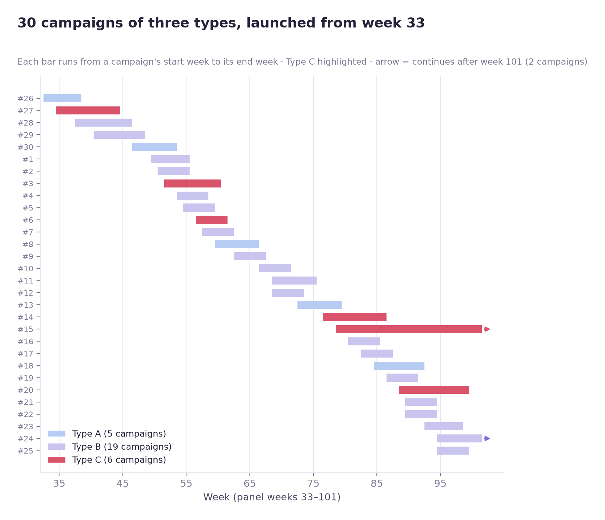
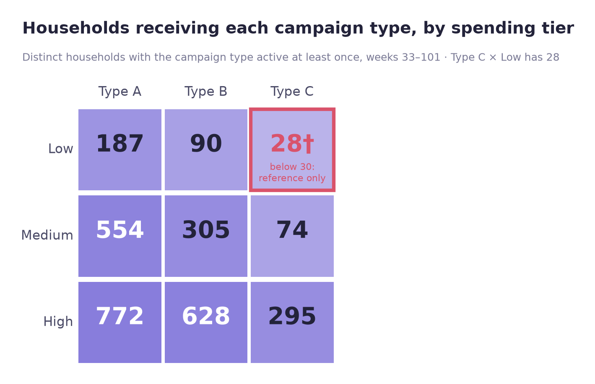
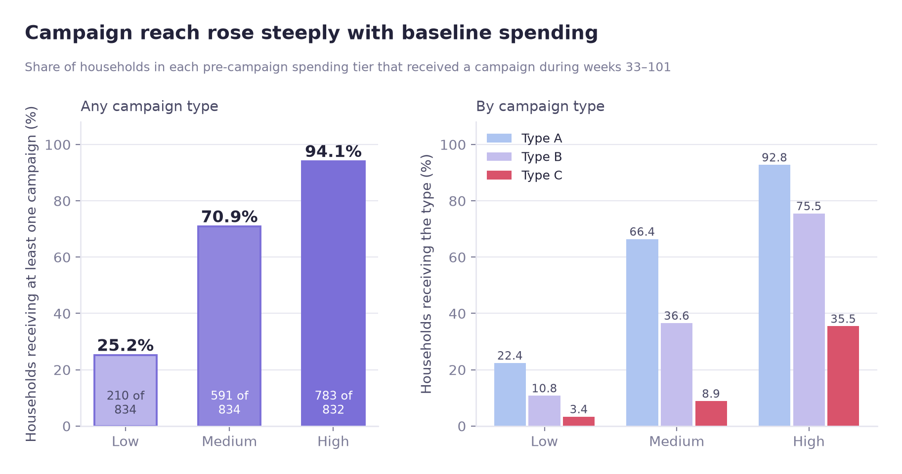
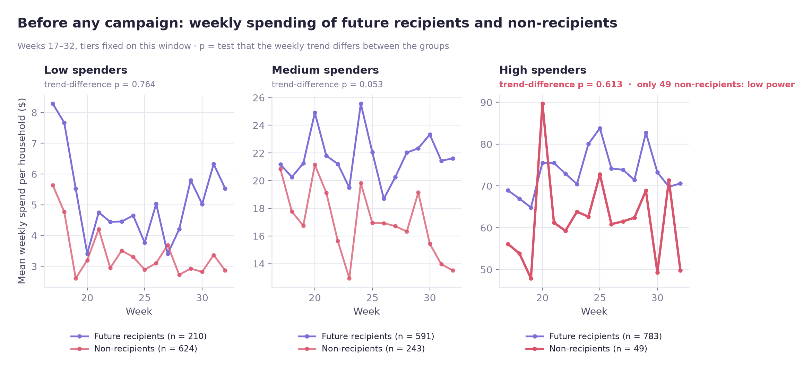
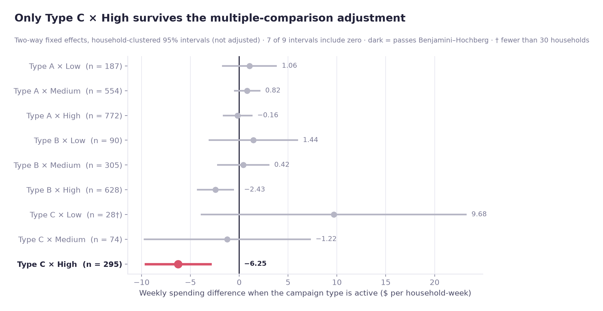
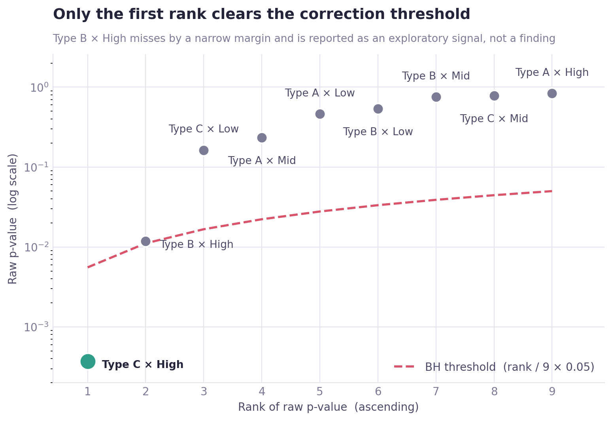
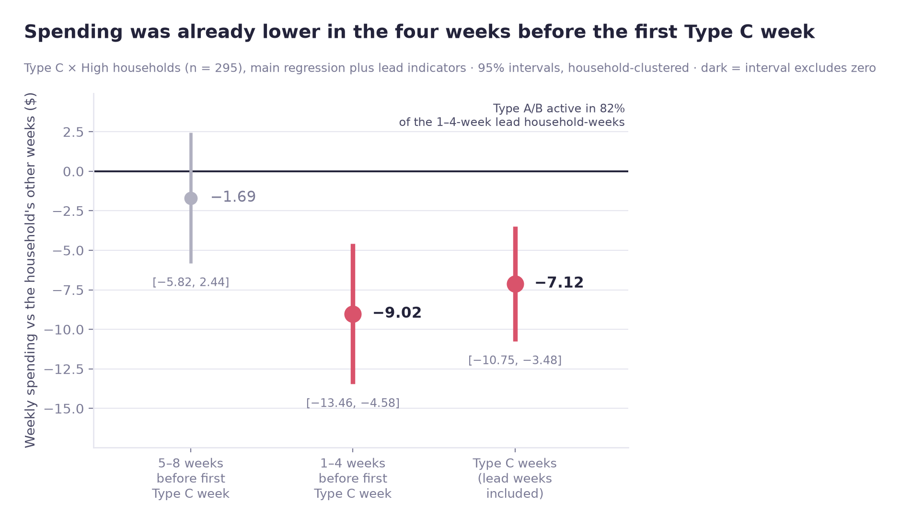

# 캠페인 유형과 고객 지출 수준에 따라 매출 변화가 달랐을까?

[English](README.md)

전체 케이스 스터디(영문): https://jiwoon-oh.github.io/portfolio/projects/dunnhumby-customer/case2/

## 분석 질문

Dunnhumby의 고객·구매·캠페인 데이터를 이용해 **같은 캠페인을 받더라도 평소 지출이 높은 고객과 낮은 고객의 반응이 다른지** 확인했다. 단순히 캠페인을 받은 가구의 매출이 높았는지 보는 것으로는 충분하지 않았다. 원래 돈을 많이 쓰는 가구가 캠페인 대상으로 더 자주 선정됐을 수 있기 때문이다.

가구별로 캠페인 전에 지출 수준을 정해 두고, 캠페인이 시작된 뒤 같은 가구의 주간 매출 변화를 살펴봤다. 가구 고정효과, 주차 고정효과, 가구 단위 클러스터 표준오차를 사용했고, 사전추세·다중비교·위약 성격의 비교·선행 효과 검정까지 확인했다.

**결론부터 말하면 Type C 캠페인과 고지출 가구의 주간 지출 감소 사이에는 통계적으로 유의한 연관성이 있었다.** 저지출의 단순 +242% 격차는 고정효과 후에 이어지지 않는다. 저지출의 세 타입 추정치는 모두 0과 구별되지 않았다(원 p 최솟값 0.163). Type C 추정치 자체도 캠페인 효과로 읽을 수 없다. 가구의 첫 Type C 주 직전 4주에 이미 지출이 낮았고(Lead4 −9.02), 그 이전 5~8주에서는 그렇지 않았다. 가구가 어떻게 선정됐는지, 예상 효과, 그 시기에 진행된 Type A·B 캠페인을 구분할 수 없다. 따라서 이 분석을 캠페인 효과가 아니라 연관성으로 보고한다.

## 0. 먼저 정한 분석 원칙

| 설계 결정 | 이유 |
|---|---|
| 고객 지출 등급은 17~32주에 고정 | 캠페인 이후 지출로 등급을 정하면 사후 정보를 사용해 순환논리가 생김 |
| 가구 고정효과 | 가구마다 원래 다른 평균 지출 수준을 고려하기 위해 |
| 주차 고정효과 | 연휴·계절 등 여러 가구에 동시에 작용하는 주간 변화를 고려하기 위해 |
| 가구 클러스터 표준오차 | 같은 가구의 여러 주 관측치가 서로 독립적이지 않기 때문에 |
| 3개 등급을 본 분석, 5분위를 보조 분석 | Type C는 일부 조합의 표본이 적어서 세분화할수록 추정이 불안정함 |
| 9개 조합의 다중비교 보정 | 여러 계수를 한꺼번에 확인하며 생기는 거짓 발견 문제를 줄이기 위해 |

고정효과가 모든 선택편향을 없애주는 것은 아니다. **가구 안에서도 시간에 따라 변하면서 캠페인 발송과 지출에 함께 영향을 미치는 요인**은 남을 수 있다.

---

## 1단계. 캠페인이 시작되기 전의 지출로 고객 나누기

첫 캠페인 시작은 33주였다. 따라서 17~32주의 16주 평균 주당 지출을 계산해서 2,500가구를 세 그룹으로 나눴다. 이 기준은 이후 단계에서 다시 계산하지 않았다.

| 고객군 | 가구 수 | 평균 주간 지출 | 범위 |
|---|---:|---:|---:|
| 저지출 | 834 | $3.85 | $0.00 ~ $10.03 |
| 중지출 | 834 | $20.36 | $10.05 ~ $33.88 |
| 고지출 | 832 | $72.75 | $33.88 ~ $378.60 |

17~32주에 거래 기록이 없는 142가구(5.7%)는 이 구간의 지출이 0으로 기록되면서 저지출군에 들어갔다. 실제로 장기간 활동이 없는 고객과 지출이 낮은 고객이 섞일 수 있으므로, 이후 소표본과 바닥효과 문제를 따로 점검했다.

5분위로 나누면 맨 위와 맨 아래의 평균 지출은 $93.14 대 $1.61로 약 58배 차이였다. 이는 고객군 간 지출 규모가 충분히 다르다는 서술적 근거지만, 그 자체로 캠페인 효과가 있다는 뜻은 아니다.

## 2단계. 캠페인 기간과 수신 가구 연결

`campaign_desc`의 `START_DAY`와 `END_DAY`를 `WEEK_NO` 기준으로 맞췄다.

| 항목 | 확인 결과 |
|---|---|
| 첫 캠페인 시작 | 33주 (그 이전에 시작한 캠페인 없음) |
| 마지막 캠페인 종료 | 102주 |
| 캠페인 수 | Type A 5건 / Type B 19건 / Type C 6건 |
| Type A 고유 수신 가구 | 1,513 |
| Type B 고유 수신 가구 | 1,023 |
| Type C 고유 수신 가구 | 397 |
| 캠페인을 받지 않은 가구 | 916 |
| 두 가지 이상 타입을 받은 가구 | 1,008 (수신 가구의 63.6%) |

Type A를 단순히 '일부 고객만 받는 개인화 캠페인'으로 보기에는 도달 범위가 넓었다. 전체 2,500가구 중 60.5%가 수신했고, 수신 가구당 평균 2.63회 발송됐다. 따라서 대상이 아주 좁은 캠페인이라기보다 **넓은 도달 범위에서 발송 내용이 개인화됐을 가능성**을 고려했다.

또 한 가구가 여러 캠페인을 동시에 받을 수 있었다. 캠페인별 효과를 독립적으로 읽을 수 없는 이유 중 하나다.



## 3단계. 가구 × 주차 패널 만들기

33~101주를 대상으로 **172,500행**의 가구·주차 패널을 구성했다. 102주는 패널에 없다. 데이터가 711일에서 끝나 그 주에는 6일치 거래만 있다. 가구별 주간 지출과 각 주차의 캠페인 활성 여부를 같은 테이블에 정리했다.

### 같은 주에 여러 캠페인을 받은 경우

- 두 타입 이상을 수신한 1,008가구 중 **869가구(86.2%)**가 같은 주에 복수 타입을 받았다.
- Type A와 B가 동시에 활성화된 기록은 **3,530건**으로 가장 많았다.

이 구조에서는 캠페인 타입별 설명변수가 서로 겹칠 수 있으므로, 본 회귀 전에 VIF를 확인하기로 했다.

### 단순 비교에서는 모두 매출이 늘어 보였다

고정효과 없이 **어떤 타입이든 캠페인이 활성인 가구-주**와 비활성인 가구-주를 계층별로 풀링해 비교하면 지출은 저지출 **+242%**($11.54 → $39.49; 활성 2,924가구-주 대 비활성 54,622가구-주), 중지출 **+60%**, 고지출 **+23%**($61.68 → $75.61)였다. 평소 지출이 다른 가구가 섞여 있고 캠페인 타입도 구분하지 않았으므로 캠페인 효과가 아니며, **6단계 추정치의 보정 전 값도 아니다.** 6단계는 가구 자신의 다른 주와 비교하는 타입별 추정이다(Type C 추정치는 고지출만 해당).

## 4단계. 타입 × 고객군 표본 수 확인

| 고객군 | Type A | Type B | Type C |
|---|---:|---:|---:|
| 저지출 | 187 | 90 | **28** |
| 중지출 | 554 | 305 | 74 |
| 고지출 | 772 | 628 | 295 |

Type C·저지출 조합은 28가구라 특히 불안정했다. 5분위로 더 나누면 Type C의 1분위가 16가구, 2분위가 25가구로 줄어든다. 따라서 본 분석에는 3계층을 사용하고 5분위는 보조적으로만 살펴봤다.



이 단계에서 캠페인 발송 자체가 균등하지 않다는 사실도 확인했다.

- 저지출 가구 도달률: **25.2%**
- 고지출 가구 도달률: **94.1%**

회사가 고지출 고객에게 캠페인을 집중했다는 점이 분명했다. 이 선택 과정은 해석할 때 반드시 고려해야 한다.

저지출·Type C의 28가구 중 사전 지출이 0인 가구는 2가구(7.1%)였지만, 이 확인만으로 소표본 문제가 해결되지는 않는다.



### 중간 점검: VIF

| 설명변수 | VIF 범위 |
|---|---:|
| 캠페인 타입 활성 더미 3개 | 1.06 ~ 1.09 |
| Type × 고객군 상호작용 더미 9개 | 1.02 ~ 1.12 |

수신 가구 기준 동시노출은 많았지만 전체 172,500개 패널 행 중 동시활성 행은 4.1%였다. 대부분의 행에서 캠페인 더미가 동시에 켜지지 않으므로 계산된 VIF는 낮았다. **이번 사양에서 심각한 선형 다중공선성은 확인되지 않았다.** 다만 VIF가 낮아도 캠페인 발송의 선택편향이나 동시노출의 해석 문제는 남는다.

## 5단계. 사전 평행추세 확인

캠페인 수신 예정 가구와 미수신 가구가 캠페인 전부터 서로 다른 방향으로 지출을 바꾸고 있었다면, 사후 변화의 원인을 캠페인만으로 설명하기 어렵다. 이를 확인하기 위해 17~32주 자료를 사용했다.

진행 중 **거래가 발생한 가구만 분모에 포함하는 오류**를 발견했다. 이 방식은 사전 지출이 없던 142가구를 누락시키므로, 전체 2,500가구 기준으로 그룹 수를 다시 계산하고 검정을 재실행했다.

| 비교 | 사전추세 상호작용계수 | p-value | 해석 |
|---|---:|---:|---|
| 전체 | 0.296 | 0.087 | 5%에서는 비유의, 10% 수준에서는 경계 |
| 저지출 | 0.025 | 0.764 | 뚜렷한 차이 미검출 |
| 중지출 | 0.308 | 0.053 | 5% 기준 바로 위 |
| 고지출 | 0.333 | 0.613 | 미검출, 비교군이 49가구뿐 |

전체와 중지출 집단에서 경계적인 신호가 있었고, 고지출 집단은 비교군 표본이 적었다. **p-value가 0.05보다 크다고 평행추세가 입증되는 것은 아니다.** 이 결과는 뒤의 인과 해석에 제약이 된다.



## 6단계. 가구·주차 고정효과 회귀

주간 지출을 종속변수로 두고 9개의 Type × 고객군 상호작용을 설명변수로 포함했다.

```text
weekly_spend ~ (TypeA × low/mid/high)
             + (TypeB × low/mid/high)
             + (TypeC × low/mid/high)
             + household fixed effects
             + week fixed effects
```

표준오차는 가구 단위로 클러스터링했다. 한 가구의 69주 기록이 모두 독립적이라고 볼 수 없기 때문이다.

| 진단 | 값 | 읽는 방법 |
|---|---|---|
| Within R² | 0.0004 | 캠페인 변수가 가구 내 주간 지출 변동 중 설명하는 비율은 매우 작음 |
| Poolability F-test | 38.138, `p < 0.0001` | 고정효과의 필요성을 뒷받침 |
| F-test(비클러스터) | 11.544, `p < 0.0001` | 상관을 무시한 추정 |
| F-test(가구 클러스터) | 2.313, `p = 0.0135` | 반복 관측 상관 반영 시 검정이 덜 낙관적 |

비클러스터와 클러스터 표준오차의 차이가 컸기 때문에, 가구 내 반복 관측을 고려하는 것이 중요했다.

### 9개 조합 전체

| 캠페인 타입 | 지출 계층 | 수신 가구 | 계수 | 클러스터 SE | 95% CI | 원 p | BH 보정 p |
|---|---|---:|---:|---:|---|---:|---:|
| Type A | 저지출 | 187 | 1.06 | 1.43 | [−1.75, 3.86] | 0.4607 | 0.8055 |
| Type A | 중지출 | 554 | 0.82 | 0.69 | [−0.53, 2.17] | 0.2333 | 0.5249 |
| Type A | 고지출 | 772 | −0.16 | 0.77 | [−1.68, 1.35] | 0.8337 | 0.8337 |
| Type B | 저지출 | 90 | 1.44 | 2.34 | [−3.14, 6.02] | 0.5370 | 0.8055 |
| Type B | 중지출 | 305 | 0.42 | 1.36 | [−2.25, 3.09] | 0.7591 | 0.8337 |
| Type B | 고지출 | 628 | −2.43 | 0.97 | [−4.32, −0.54] | 0.0118 | 0.0532 |
| Type C | 저지출 | 28† | 9.68 | 6.94 | [−3.93, 23.28] | 0.1633 | 0.4898 |
| Type C | 중지출 | 74 | −1.22 | 4.36 | [−9.77, 7.33] | 0.7798 | 0.8337 |
| **Type C** | **고지출** | 295 | **−6.25** | 1.76 | [−9.70, −2.81] | 0.0004 | **0.0033** |

계수는 해당 타입 캠페인이 활성인 가구-주의 주당 지출을 그 가구의 다른 주와 비교한 값(달러)이다. 구간은 다중비교 보정을 하지 **않은** 95% 구간이며 9개 중 7개가 0을 포함한다. 굵게 표시한 행만 Benjamini–Hochberg 보정 후에도 유의하다. † 30가구 미만: 참고용.

### 보정 전 p-value에서 유의했던 두 조합

| 조합 | 회귀계수 | p-value | 가구 수 | 해당 고객군의 평소 지출 대비 |
|---|---:|---:|---:|---:|
| **Type C × 고지출** | **−6.25** | **0.0004** | 295 | 약 **−8.6%** |
| Type B × 고지출 | −2.43 | 0.0118 | 628 | 약 −3.3% |

나머지 7개 조합은 5% 기준에서 유의하지 않았다. 특히 Type C·저지출은 표본 28가구에 `p = 0.163`으로, 계수의 크기만 보고 해석하기 어려웠다.

단순 비교와 고정효과 추정은 서로 다른 질문에 답한다. 단순 비교는 한 계층 안에서 모든 타입의 활성 주를 풀링했고, 고정효과 모형은 가구 자신의 Type C 주를 그 가구의 다른 주와 비교하며(주차 효과와 다른 타입은 고정) 같은 집단의 보정 전후로 읽어서는 안 된다. 고정효과가 무엇을 바꾸는지 보이려면 계층별 '어떤 캠페인이든' 더미 하나로 모형을 따로 추정해야 하는데 이번에는 하지 않았다. 고정효과가 타깃팅 편향을 모두 제거했다는 증거는 아니다.



## 7단계. 9번 비교한 결과 보정하기

9개의 조합을 각각 5% 기준으로 검정하면 우연한 발견이 생길 수 있다. Benjamini–Hochberg(BH) 방식으로 FDR을 보정했다.

| 순위 | 조합 | 원래 p | BH 임계값 | 보정 p | 결과 |
|---|---|---:|---:|---:|---|
| 1 | Type C × 고지출 | 0.000371 | 0.00556 | **0.0033** | 유지 |
| 2 | Type B × 고지출 | 0.011832 | 0.01111 | 0.0532 | 5% 기준 탈락 |

최종적으로 **Type C × 고지출**만 9개 조합 가운데 보정 후에도 유의했다. Type B × 고지출은 단일 검정만 보면 유의했지만, 전체 비교를 고려하면 추가 확인이 필요한 수준으로 낮춰 해석했다.



## 8단계. 이미 진행 중이던 하락이 있었는지 확인하기

Type C가 고지출 가구의 매출을 낮췄다는 해석 말고 다른 설명이 가능하다. 회사가 **이미 지출이 감소하기 시작한 고객을 붙잡으려고** Type C를 보냈을 수 있다. 이를 확인하려고 두 가지를 봤다. 캠페인을 한 번도 받지 않은 가구의 비교와, 각 가구의 첫 Type C 주 직전 구간에 대한 선행 효과 검정이다.

### 미수신 가구의 초반·후반 지출 비교

캠페인을 한 번도 받지 않은 **916가구**를 사용했다.

| 고객군 | 33~42주 평균 | 92~101주 평균 | 변화율 |
|---|---:|---:|---:|
| 저지출 | $4.61 | $12.25 | +165.5% |
| 중지출 | $11.27 | $17.33 | +53.8% |
| 고지출 | $43.96 | $43.54 | −1.0% |

고지출 미수신 가구의 지출은 단순 비교에서 거의 변하지 않았다. 하지만 이 그룹에는 49가구밖에 없어 신뢰할 만한 결론을 내리기 어려웠다.

### 미수신 가구의 위약 성격 회귀

| 항 (미수신 가구) | 계수 | p-value | 95% CI | 해당 고객군 가구 수 |
|---|---:|---:|---|---:|
| 중지출 × 후반기간 | 0.05 | 0.9510 | [−1.60, 1.70] | 243 |
| 고지출 × 후반기간 | −4.74 | 0.2609 | [−13.00, 3.52] | 49 |

이 계수들은 **저지출 고객군을 기준**으로 측정되고, 모두에게 공통인 변화는 주차 고정효과가 흡수한다. 각 계수는 그 고객군의 후반기간(67~101주 대 이전) 변화에서 저지출 고객군의 같은 기간 변화를 뺀 값이다. 위 표에서 저지출 미수신 가구는 165.5% 증가했으므로, 고지출 × 후반기간 계수의 상당 부분은 고지출의 하락이 아니라 저지출의 성장에서 나올 수 있다. 이는 **6단계 추정치와 같은 양이 아니다.** 6단계는 한 가구의 Type C 주를 그 가구의 다른 주와 비교하므로 두 숫자를 서로 비교하지 않는다.

### 선행 효과 검정: 첫 Type C 주 직전의 지출

이 검정은 6단계와 같은 가구, 같은 종류의 비교를 쓴다. Type C를 받은 고지출 295가구에 대해 본 회귀에 두 지시변수를 추가했다. **Lead4**(가구의 첫 Type C 주 이전 4주)와 **Lead8**(이전 5~8주)이다. 가구·주차 고정효과, 가구 단위 클러스터 표준오차, 같은 9개 타입×고객군 변수를 그대로 쓰므로 Type A·B 활성은 6단계처럼 통제된다. 판독 기준은 실행 전에 정했다. 95% 구간이 0을 포함하면 사전 하락의 증거 없음, 계수가 음수이고 구간이 0을 제외하면 역방향 타깃팅 가능성이다.

| 항 | 계수 | 클러스터 SE | 95% CI | p-value | 가구 수 | 판독 |
|---|---:|---:|---|---:|---:|---|
| Lead4 (−4~−1주) | **−9.02** | 2.26 | [−13.46, −4.58] | <0.0001 | 295 | 역방향 타깃팅 가능성 |
| Lead8 (−8~−5주) | −1.69 | 2.11 | [−5.82, 2.44] | 0.4233 | 286 | 사전 하락의 증거 없음 |

가구의 첫 Type C 주 직전 4주의 지출은 그 가구의 다른 주보다 주당 약 $9.02 낮았고 구간이 0을 제외했다. 그 이전 5~8주에서는 차이가 감지되지 않았다. 두 선행 계수를 함께 보면 0과 다르다(결합 Wald 검정 p = 0.0003). 선행 변수를 넣으면 Type C × 고지출 계수는 −6.25가 아니라 −7.12(95% CI [−10.75, −3.48])다. 검정을 둘 수행했고 다중비교 보정은 하지 않았다.

한계: 295가구 중 260가구는 Lead4 구간에 Type A 또는 B 캠페인이 활성이었다(해당 가구-주의 82%). 따라서 Type C 이전의 지출 하락을 예상 효과나 그 캠페인들의 효과와 구분할 수 없다. 9가구는 선행 구간이 33주 이전에 걸려 패널 밖이다.



## 추가 강건성: 최초 노출과 재노출

Type C·고지출 조합을 첫 노출과 재노출로 나눠 다시 살펴봤다.

| 구분 | 가구 수 | 계수 | p-value |
|---|---:|---:|---:|
| 최초 노출 | 295 | −4.89 | 0.009 |
| 재노출 | 131 | −9.09 | 0.003 |

두 경우 모두 음의 연관성이 유지됐다. 그러나 재노출 때 계수가 더 작았다는 사실만으로 '반복 노출이 할인 대기 심리를 강화했다'고 결론 내리지는 않았다. 지출이 더 빠르게 감소하는 고객이 반복 타겟팅됐을 가능성도 있기 때문이다.

## 결과를 어떻게 해석할까

**관측한 사실:** 고지출 가구가 Type C를 받은 주에는 그 가구의 평소 수준 및 전체 주차 공통효과를 고려해도 주간 지출이 평균 약 $6.25 낮게 나타났다. 이 연관성은 BH 보정 이후에도 남았다(`p_adj = 0.0033`).

**선행 효과 검정이 더하는 것:** 가구의 첫 Type C 주 직전 4주에 그 가구의 지출은 이미 다른 주보다 주당 약 $9.02 낮았다(95% CI [−13.46, −4.58]). 그 이전 5~8주에는 차이가 없었다. 이 선행 주를 고려하면 Type C 계수는 −7.12다. Type C는 대상을 골라 보냈으므로 시점이 무작위가 아니다. 노출 직전의 하락은 가구 선정 방식, 예상 효과, 그 구간의 82%에서 활성이던 Type A·B 캠페인 중 무엇에서든 나올 수 있고, 데이터로는 구분할 수 없다. 따라서 이 추정치를 Type C의 효과로 읽을 수 없다.

**아직 구분하지 못한 설명:**

1. Type C가 구매 시점을 미루거나 할인 대기를 유도했을 수 있다.
2. 회사가 이미 지출이 떨어지는 고지출 가구에게 Type C를 더 자주 보냈을 수 있다. 8단계 선행 효과 검정에서 노출 직전 4주의 지출이 낮았고, 이는 이 설명과도 예상 효과와도 맞는다.
3. 특정 시점의 다른 고객 상황이 캠페인 발송과 구매에 함께 영향을 줬을 수 있다.
4. Type C 직전 몇 주 동안 진행된 Type A·B 캠페인이 지출을 바꿨을 수 있다(Lead4 가구-주의 82%에서 활성).

현재 데이터로는 첫 번째 설명을 나머지 설명과 분리하기 어렵다. 따라서 이 결과는 **캠페인과 주간 지출의 연관성**으로 보고한다.

## 한계와 개선 방향

| 한계 | 의미 및 개선 가능성 |
|---|---|
| 소표본 | Type C·저지출 28가구, 고지출 미수신 49가구 → 추정치 불안정. 더 많은 비교군 확보 필요 |
| 사전추세 | 전체·중지출 집단의 p가 경계에 위치. 추세가 비슷하다는 가정을 강하게 주장하기 어려움 |
| 캠페인 선택 규칙 미공개 | 어떤 가구가 왜 특정 주차에 발송 대상이 됐는지 알 수 없음 |
| 노출 직전의 지출 하락 | 가구의 첫 Type C 주 직전 4주에 이미 지출이 낮았음(Lead4 −9.02). 가구 선정, 예상 효과, Type A·B 캠페인을 구분할 수 없음 |
| 동시 노출 | 동일 주차에 여러 캠페인이 활성화될 수 있어 각 Type의 독립적인 효과를 분리하기 어려움 |
| 시점이 다른 반복 캠페인 | 33~101주 동안 여러 캠페인이 시작·종료되어 단순 이원고정효과 추정의 비교 구성이 복잡함 |
| Within R² = 0.0004 | 통계적으로 유의한 연관성이 있더라도 주간 지출 변동 대부분은 설명하지 못함 |
| 관찰 데이터 | 가구·주차 고정효과만으로 무작위 실험 수준의 인과적 식별은 불가능 |

시차를 두고 캠페인이 도입되는 패널에서 이원고정효과(TWFE)에 문제가 생길 수 있다는 방법론적 논의가 있다. 다만 이 데이터는 여러 번 켜지고 꺼지는 캠페인 노출이라 전형적인 '처리 후 영구 처리' 설계와도 다르다. 후속 분석에서는 캠페인별 최초 노출을 기준으로 비교집단과 시간을 더 엄밀하게 정하거나, 가능하다면 실험군과 무작위 미발송 대조군을 확보해야 한다.

## 실행 방법

```
pip install -r requirements.txt
pip install jupyter
```

버전은 노트북을 실행한 Python 3.11 환경 기준으로 고정했다.

1. Dunnhumby *The Complete Journey* CSV를 `data/`에 내려받는다(`data/README.md` 참고). git에는 올라가지 않는다.
2. 저장소 루트에서 아래 순서로 노트북을 실행한다. 경로와 `SEED = 42`는 `config.py`에서 정한다. 뒤쪽 노트북은 앞선 노트북이 `outputs/`에 쓴 CSV를 다시 쓴다.

   ```
   python -m nbconvert --to notebook --execute --inplace <notebook>.ipynb
   ```

   `dunnhumby_data_overview`, `h2_stage1_2_tier_campaign_mapping`, `h2_stage3_panel`, `h2_stage4_cell_size`, `h2_stage5_pretrend`, `h2_stage6_main_regression`, `h2_stage7_multiple_comparison`, `h2_stage8_placebo_test`, 마지막으로 `h2_figures`(`images/`의 모든 그림을 `outputs/`에서 그림, `TRANSPARENT = True`로 바꾸면 투명 배경 버전).
3. 결과 CSV는 `outputs/`에 저장된다. 가구 단위 중간 파일은 `outputs/intermediate/`에 저장되며 커밋하지 않는다.

## 사용한 분석 방법

- 가구별 캠페인 이전 지출 기반 세그먼트 고정
- 캠페인 유형·기간 매핑 및 가구×주차 패널 구축
- 도달률·중복노출·VIF 진단
- 사전 평행추세 확인과 분모 오류 수정
- 가구·주차 고정효과 회귀, 가구 클러스터 표준오차
- Type×고객군 상호작용 9개 비교, BH 보정
- 미수신 가구 비교, 선행 효과 검정, 최초·재노출 강건성 확인

**정리:** 발견한 결과는 'Type C가 고지출 고객에게 해롭다'가 아니라 '**Type C 노출과 고지출 고객의 지출 감소가 같은 시점에 관찰됐다**'이다. 다만 고지출 가구의 지출은 첫 Type C 주 직전 4주에 이미 낮았고(Lead4 −9.02), 가구 선정·예상 효과·Type A·B 캠페인을 구분할 수 없다. 저지출의 단순 +242% 격차는 고정효과 후 이어지지 않았다. 캠페인 효과가 아니라 연관성으로 보고한다. 왜 그런지 판단하려면 발송 규칙과 비교군에 대한 추가 정보가 필요하다.
