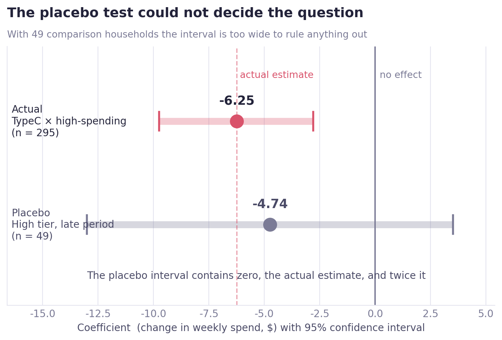

# Did Campaign Type and Prior Spending Level Affect Weekly Household Sales Differently?

[한국어](README.ko.md) · [Project folder](https://github.com/jiwoon-oh/ai-data-bootcamp/tree/main/project-dunnhumby/campaign-customer)

## Research question

Using Dunnhumby's household transactions and campaign records, I examined whether changes in weekly spending during campaign periods differed across **low-, medium-, and high-spending households**. A comparison of households that received campaigns with those that did not would be misleading: a retailer might send more offers to customers who already spend a lot.

I defined spending tiers using pre-campaign data, built a household-week panel, and estimated campaign-by-tier associations using household and week fixed effects with household-clustered standard errors. I then checked pre-trends, adjusted for multiple comparisons, and ran a placebo test.

**The main finding was a negative association between Type C campaigns and weekly spending among high-spending households.** It survived multiple-testing adjustment. However, I could not determine whether the campaign reduced spending or whether the retailer targeted households whose spending had already started to decline. I therefore report an association, not a proven causal effect.

## 0. Analysis decisions made in advance

| Decision | Reason |
|---|---|
| Fix tiers using Weeks 17–32 | Segmenting on post-campaign spending would introduce look-ahead bias |
| Household fixed effects | Account for persistent differences in average spending between households |
| Week fixed effects | Account for common seasonal and calendar-related changes |
| Cluster standard errors by household | Weekly observations within one household are correlated |
| Use three tiers for the main model and five quintiles as a check | Small campaign-by-tier cells become unstable with too much segmentation |
| Correct nine statistical comparisons | Reduce false discoveries from testing many campaign interactions |

Fixed effects are not a cure for every type of selection bias. Unobserved factors that change within a household over time and affect both campaign targeting and spending can still influence the estimates.

---

## Step 1. Assign spending tiers before the campaigns begin

The first campaign started in Week 33. I used each household's average weekly spend over **Weeks 17–32** to group the 2,500 households. I kept those assignments unchanged throughout the study.

| Tier | Households | Mean weekly spending | Range |
|---|---:|---:|---:|
| Low | 834 | $3.85 | $0.00–$10.03 |
| Medium | 834 | $20.36 | $10.05–$33.88 |
| High | 832 | $72.75 | $33.88–$378.60 |

There were **142 households (5.7%)** without purchases during this pre-period. Their measured spending was zero, placing them in the lowest tier. This creates a possible floor effect: a household with no recorded activity may behave differently from an otherwise active but low-spending customer.

With five quintiles, mean spending in the top and bottom groups was approximately **$93.14 versus $1.61**, a nearly 58-fold gap. This describes how different the groups were before exposure; it is not evidence of a campaign effect.

## Step 2. Map campaign type and active weeks

I mapped `START_DAY` and `END_DAY` from `campaign_desc` to weekly periods.

| Item | Result |
|---|---|
| First campaign | Week 33; none started beforehand |
| Last campaign ended | Week 102 |
| Campaigns by type | Type A: 5; Type B: 19; Type C: 6 |
| Distinct Type A recipients | 1,513 |
| Distinct Type B recipients | 1,023 |
| Distinct Type C recipients | 397 |
| Never received any campaign | 916 |
| Received more than one type | 1,008, or 63.6% of recipients |

Type A reached **60.5%** of all 2,500 households, with recipients receiving it an average of **2.63 times**. That is broad reach for something described as a personalized campaign. The content may have been personalized, but its audience was not particularly narrow.

Different campaigns also overlapped. This complicates any attempt to isolate the response to one type.

## Step 3. Construct the household-week panel

The main panel covered **Weeks 33–101** and contained **172,500 rows**. For each household and week, I aligned spending with indicators for whether each campaign type was active.

### Overlapping exposure

- Among the **1,008 households** receiving multiple types, **869 (86.2%)** experienced at least one week when multiple types overlapped.
- Type A + Type B accounted for **3,530** simultaneous-exposure records, the most common combination.

I therefore checked variance inflation before interpreting a regression containing all campaign-by-tier indicators.

### Why the raw percentages were not enough

A simple campaign-week comparison suggested spending increases of **+242% for low**, **+60% for medium**, and **+23% for high** spenders. These comparisons do not adjust for household differences or common shifts in spending. They cannot be interpreted as campaign lift. The fixed-effects estimates later produced a different pattern among high spenders.

## Step 4. Check campaign-by-tier sample sizes

| Tier | Type A | Type B | Type C |
|---|---:|---:|---:|
| Low | 187 | 90 | **28** |
| Medium | 554 | 305 | 74 |
| High | 772 | 628 | 295 |

Only 28 low-spending households received Type C. With five spending quintiles, the lowest two Type C cells had only **16 and 25 households**. This confirmed that a three-tier model was more appropriate for the main analysis.

Targeting was strongly related to pre-campaign spending:

- Campaign reach among low spenders: **25.2%**
- Campaign reach among high spenders: **94.1%**

The retailer was far more likely to contact high-spending customers, so raw recipient/non-recipient comparisons are not credible as causal estimates.

Among the 28 low-spending Type C households, two had zero pre-campaign spending (7.1%). This limits one particular floor-effect concern but does not solve the small-cell problem.


### Multicollinearity check: VIF

| Predictors | VIF range |
|---|---:|
| Three campaign activity indicators | 1.06–1.09 |
| Nine Type × tier interaction indicators | 1.02–1.12 |

Although overlapping types were common among multi-type recipients, simultaneously active campaigns appeared in only **4.1%** of all panel rows. The large share of rows without simultaneous exposure helps explain the low pooled VIF values.

I did not find serious linear multicollinearity in this specification. Low VIF does **not** resolve treatment-selection or overlapping-campaign interpretation issues.

## Step 5. Check pre-campaign trends

Before using post-campaign differences, I tested whether future recipients and non-recipients were already following different spending trends during **Weeks 17–32**.

During this step I found a denominator error: counting only households with observed purchases dropped the **142 zero-spending households**. I corrected the denominator to all **2,500 households** and repeated the test.

| Comparison | Trend interaction | p-value | Interpretation |
|---|---:|---:|---|
| Full sample | 0.296 | 0.087 | Not significant at 5%; borderline at 10% |
| Low spenders | 0.025 | 0.764 | No detected difference |
| Medium spenders | 0.308 | 0.053 | Just above 5% |
| High spenders | 0.333 | 0.613 | Low power; only 49 controls |

This was not a clean confirmation of parallel trends. The full sample and medium tier were borderline, while the high-tier comparison was based on a small number of controls. A non-significant pre-trend test does not establish that the trends truly match.

## Step 6. Two-way fixed-effects model

Weekly household spending was regressed on the nine campaign-by-tier indicators, household fixed effects, and week fixed effects.

```text
weekly_spend ~ TypeA × (low, medium, high)
             + TypeB × (low, medium, high)
             + TypeC × (low, medium, high)
             + household fixed effects
             + week fixed effects
```

I clustered standard errors at the household level because multiple observations from the same household are not independent.

| Diagnostic | Result | Interpretation |
|---|---|---|
| Within R² | 0.0004 | Campaign indicators explain very little within-household weekly variation |
| Poolability F-test | 38.138, `p < 0.0001` | Supports accounting for fixed effects |
| F-test without clustering | 11.544, `p < 0.0001` | Treats within-household errors more optimistically |
| F-test with household clustering | 2.313, `p = 0.0135` | Less overstated significance after allowing dependence |

The contrast between clustered and non-clustered tests showed why the repeated-measures structure mattered.

### Two interactions with unadjusted p-values below 0.05

| Interaction | Coefficient | Raw p-value | Households | Relative to baseline spend |
|---|---:|---:|---:|---:|
| **Type C × high spenders** | **−6.25** | **0.0004** | 295 | approximately **−8.6%** |
| Type B × high spenders | −2.43 | 0.0118 | 628 | approximately −3.3% |

The other seven comparisons did not pass the 5% threshold. Type C × low spenders, for example, had only 28 households and `p = 0.163`; its estimated coefficient should not be read without its uncertainty.

The negative fixed-effects estimates differed from the positive raw comparisons. This demonstrates how much household spending levels and common weekly trends mattered in the unadjusted analysis. It does not prove that fixed effects removed all targeting bias.


## Step 7. Adjust for testing nine interactions

Testing nine hypotheses raises the risk of chance discoveries. I used the Benjamini–Hochberg procedure to control the false discovery rate.

| Rank | Interaction | Raw p | BH threshold | Adjusted p | Result |
|---|---|---:|---:|---:|---|
| 1 | Type C × high | 0.000371 | 0.00556 | **0.0033** | Remains significant |
| 2 | Type B × high | 0.011832 | 0.01111 | 0.0532 | No longer below 0.05 |

**Only Type C × high spenders** remained statistically significant after adjusting for nine comparisons. Type B × high is an exploratory finding, not a confirmed second result.


## Step 8. Placebo test: did Type C cause the decline?

There is a competing explanation for the negative Type C result. The retailer might have sent Type C specifically to high-spending households **whose purchases were already declining**. If so, the timing of the campaign would coincide with the decline without causing it.

I used the **916 households that never received a campaign** for a placebo-style comparison.

### Early-versus-late spending among non-recipients

| Tier | Mean, Weeks 33–42 | Mean, Weeks 92–101 | Change |
|---|---:|---:|---:|
| Low | $4.61 | $12.25 | +165.5% |
| Medium | $11.27 | $17.33 | +53.8% |
| High | $43.96 | $43.54 | −1.0% |

Average high-tier spending was nearly flat in this descriptive comparison. But there were only **49 high-spending non-recipient households**, making it difficult to distinguish different plausible explanations.

### Placebo regression

| Estimate | Coefficient | p-value | 95% CI | Households |
|---|---:|---:|---|---:|
| Actual Type C × high | **−6.25** | **0.0004** | approx. [−9.7, −2.8] | 295 |
| Placebo high × late period | −4.74 | 0.261 | **[−13.00, +3.52]** | 49 |

The placebo interval contains zero and also the main estimate of −6.25. In other words, the comparison sample was too small to rule out a pre-existing decline. I cannot report that the placebo test passed or that it definitively failed to find an effect.



## Additional robustness check: first versus repeat exposure

I separated initial Type C exposure from repeat exposure within the high-spending group.

| Exposure | Households | Coefficient | p-value |
|---|---:|---:|---:|
| First exposure | 295 | −4.89 | 0.009 |
| Repeat exposure | 131 | −9.09 | 0.003 |

The negative association appeared in both subsets. The more negative repeat-exposure coefficient does not establish an accumulating campaign effect. Households already experiencing a decline could have been targeted more often.

## Interpretation

**Observed result:** During Type C exposure, high-spending households spent an estimated **$6.25 less per week**, relative to their typical spending and common week effects. This association remained statistically significant after BH correction (`adjusted p = 0.0033`).

**Plausible competing explanations:**

1. Type C may encourage customers to postpone purchases or wait for discounts.
2. Type C may have been sent to households that were already reducing their spending.
3. Other time-varying conditions may affect both campaign selection and spending.

The data do not separate these explanations convincingly. The result is a **statistically detectable association**, not an established causal campaign effect.

## Limitations and next steps

| Limitation | Implication |
|---|---|
| Small comparison cells | Type C × low has 28 households; the high-spending placebo control has 49 |
| Pre-trend uncertainty | The full sample and medium tier were near conventional significance thresholds |
| Unknown targeting criteria | Cannot reconstruct why a specific household received an offer in a specific week |
| Concurrent campaigns | Several types can be active in the same household-week |
| Campaigns start and end at different times | Comparison groups under simple two-way fixed effects can be hard to interpret |
| Within R² = 0.0004 | Even a significant coefficient explains little of total within-household spending variation |
| Observational data | Household and week fixed effects cannot replace random assignment |

The literature on two-way fixed effects has shown that staggered treatment timing can cause misleading estimates in certain designs. This panel also contains recurring campaigns that switch on and off, rather than a single permanently adopted treatment; it is not identical to the textbook staggered-adoption case. A stronger follow-up would define exposure timing and comparison groups more carefully, or ideally run a randomized holdout with some households not receiving the campaign.

## Methods covered

- Pre-campaign spending segmentation
- Campaign timing and household-week panel construction
- Exposure overlap, reach, and VIF checks
- Pre-trend testing and correction of a denominator bug
- Household and week fixed effects with household-clustered standard errors
- Nine interaction estimates and Benjamini–Hochberg adjustment
- Non-recipient placebo analysis; first versus repeat exposure checks

**Bottom line:** Type C exposure coincided with a decline in high-spending households' weekly purchases. I cannot infer from this dataset alone that Type C caused the decline.
